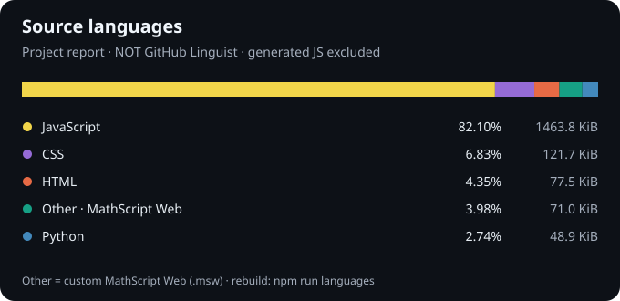

# 自訂語言與 GitHub Languages

本專案的 **MathScript Web 0.2** 使用 `.msw`，具備 reader、語法樹、作用域檢查、JavaScript 程式碼產生器與 runtime。編譯器本身以 `.msw` 撰寫，建置會核對三階段產物一致。自訂語言可以實際運作，不代表 GitHub 已將它收錄。

## GitHub 原生面板的限制

- GitHub 的 Languages 面板使用 Linguist 的語言清單與偵測規則。
- 未列入 Linguist `languages.yml` 的語言，不會因 `linguist-detectable=true` 或隨意設定 `linguist-language=Other` 而成為可統計語言。
- GitHub 顯示的 **Other** 是小比例語言的介面彙總，不是「未知語言」的指定名稱。不能保證用新的副檔名讓該面板出現 Other。
- `.gitattributes` 將本專案五份可重建的 JavaScript 產物標記為 generated，並標記 vendor 目錄。手寫 JavaScript、HTML、CSS 等仍按實際內容偵測。
- 原生統計在預設分支更新後由背景工作重新計算；只建立開發分支或 PR 不會改變 main 的語言比例。

不以大量無用檔案、假語言標籤或把所有手寫程式標成 generated 來改變百分比。後續若要讓 GitHub 原生顯示 MathScript Web，需要遵循 Linguist 的新語言收錄流程；本次沒有向 Linguist 提交或取得收錄。

官方依據：

- [GitHub repository languages](https://docs.github.com/en/repositories/managing-your-repositorys-settings-and-features/customizing-your-repository/about-repository-languages)
- [Linguist overrides：未收錄語言與 generated](https://github.com/github-linguist/linguist/blob/main/docs/overrides.md)
- [Linguist 專案對 Other 彙總的說明](https://github.com/github-linguist/linguist/discussions/7378)
- [Linguist contributing guidelines](https://github.com/github-linguist/linguist/blob/main/CONTRIBUTING.md)

## README 的自訂來源報表



上圖由本專案的腳本產生，**不是 GitHub 原生 Languages 面板**。其中 `Other · MathScript Web` 明確指 `.msw` 自訂語言來源；它不會修改 GitHub 的分類器。

```sh
npm run languages
npm run languages:check
```

計算規則：以 Git 追蹤及尚未忽略的新檔案為集合，計算磁碟上 UTF-8 原始碼的位元組數。納入 `.js`／`.cjs`／`.mjs`（JavaScript）、`.msw`（Other · MathScript Web）、`.html`（HTML）、`.css`（CSS）、`.py`（Python）。排除 vendor 目錄、同路徑有 `.msw` 來源的 `.js` 產物，以及其他副檔名（文件、JSON 資料、圖像、字型等）。測試與建置工具也是手寫程式，因此納入。

這是本專案定義的「作者原始碼」口徑，不宣稱完整模擬 Linguist 的所有排除規則。分母包括上列五類來源的總位元組數；四捨五入的百分比可能不恰好合計 100%。修改來源後應重新產生報表。原始數據與逐檔清單保存在 [source-languages.json](source-languages.json)。
